# 🎬 Awesome Desktop Media Player & Novel Reader Ecosystem 📚

  

  
  
  
  
  

---

## 🌟 Top Desktop Media Player & Novel Reader Ecosystem 🚀

**Curated List of SaaS/Hosted Platforms & Open-Source GitHub Projects**  
*Focused on Hardware-Accelerated Desktop Media Players, Self-Hosted Streaming Servers, E-Book/Light-Novel Readers, and Cross-Platform Entertainment Hubs.*  

📅 **Last updated:** November 2026

Welcome to the definitive guide and curated collection of **desktop media players, light novel readers, e-book engines, and homelab media streaming servers**. Whether you are building an ultra-fast local anime workstation with real-time GLSL upscalers, configuring a personal home cloud library with hardware transcoding, or seeking distraction-free desktop novel readers with dual-page dictionary translation, this repository covers both top enterprise SaaS platforms and battle-tested open-source software.

🔍 **SEO Keywords & Search Topics:** *Desktop Media Player, E-Book Reader, Light Novel Reader, Hardware-Accelerated Video, MPV, VLC, Jellyfin, Plex Server, Calibre, Foliate, Koodo Reader, Web Novel Scraper, Anime4K, Self-Hosted Media Server, HTPC 4K HDR, EPUB Reader Windows macOS Linux.*

---

## 📑 Table of Contents 📌

- [📊 Sector Overview & Market Dynamics](#-sector-overview--market-dynamics)
- [💼 SaaS & Commercial Hosted Platforms](#-saas--commercial-hosted-platforms)
- [💻 Open-Source GitHub Projects](#-open-source-github-projects)
- [🛠️ Recommended Stack Combinations](#️-recommended-stack-combinations)
- [🤝 How to Contribute](#-how-to-contribute)
- [☕ Support & Share](#-support--share)
- [📈 Star History](#--star-history)
- [📜 Disclaimer](#-disclaimer)

---

## 📊 Sector Overview & Market Dynamics 📈

The global desktop multimedia player, digital reading, and personal media server market is estimated at **$14.8 billion in 2026** (encompassing digital publishing, e-reader software, streaming media servers, and commercial playback engines, projected to grow at a CAGR of 8.4% through 2032). 

The industry exhibits a **moderately fragmented and bifurcated structure**:
- **Commercial & Ecosystem Tier:** Concentrated around multi-billion-dollar tech giants (Amazon Kindle, Kakao PotPlayer, Times Internet MX Player) who leverage captive digital stores and advertising ecosystems.
- **Enthusiast & Homelab Tier:** Highly fragmented and dominated by community-driven open-source projects (`mpv`, `Jellyfin`, `Calibre`, `VLC`) offering privacy, self-sovereignty, and local hardware acceleration without vendor lock-in.

---

## 💼 SaaS & Commercial Hosted Platforms 🌐

The following table presents notable commercial platforms, cloud streaming servers, and desktop reading suites. Products are sorted in **descending order by company scale (valuation / market capitalization / estimated enterprise valuation)**.

| Product & Platform | Company Size (Valuation / Revenue) | Starting Pricing (Paid Tiers) | Free Tier / Free Trial Limits | Target Use Cases & Key Features |
| :--- | :--- | :--- | :--- | :--- |
| 📚 **[Kindle Desktop & Cloud Reader](https://amazon.com)** | **$2.2 Trillion** *(Amazon Market Cap)* | **$11.99/month** (Kindle Unlimited subscription) | **Free forever client app**; includes sample chapters (first 10–20% of books) and access to free public domain books without expiration | Cross-device Whispersync across Windows/macOS desktop and mobile, instant dictionary/X-Ray lookups, and millions of DRM-protected novels. |
| 🎬 **[PotPlayer](https://daum.net)** | **~$12 Billion** *(Kakao Corp Market Cap)* | **$0.00** (Ad-supported freeware suite) | **Free forever fully featured**; monetized via contextual display ads in interface panel, no feature paywalls or trial expiry | Ultra-low latency Direct3D/CUDA/DXVA hardware decoding, custom shaders, 3D video support, and granular subtitle manipulation for Windows. |
| 📱 **[MX Player Pro](https://mxplayer.in)** | **~$4.5 Billion** *(Times Internet / Parent Holding Valuation)* | **$5.99 one-time purchase** (Pro version ad-free) | **Free forever base version** (free with ad banners); includes 100% of multi-core decoding & subtitle gestures with no expiration | Multi-core hardware decoding engine, gesture scrubbing controls, and comprehensive subtitle format support across desktop emulators and Android. |
| 🍿 **[Plex & Plex Pass](https://plex.tv)** | **~$1.2 Billion** *(Plex Inc. Private Valuation)* | **$4.99/month**, **$39.99/year**, or **$119.99 lifetime** | **Free forever base server & web playback**; includes remote streaming and free FAST live TV channels; mobile playback restricted to 1-min preview without Plex Pass or $4.99 unlock fee | Cloud-connected personal media server, GPU hardware transcoding, automated metadata/subtitles scraping, remote relay, and live TV DVR. |
| ☁️ **[Ultra.cc Managed Media Seedbox](https://ultra.cc)** | **~$35 Million** *(Private Hosting Cloud ARR)* | **€5.80/month** (~$6.25/mo for 1TB slot) | **7-day money-back guarantee**; unmetered bandwidth on high-speed 20Gbps/50Gbps ports with full refund if cancelled within 7 days | One-click managed cloud hosting for Jellyfin, Plex, Kodi, Deluge, and WebDAV media libraries with automated maintenance and high-bandwidth streaming. |
| 📺 **[Infuse Pro (Firecore)](https://firecore.com)** | **~$15 Million** *(Firecore LLC Estimated Valuation)* | **$1.99/month**, **$14.99/year**, or **$114.99 lifetime** | **Free forever standard edition** (plays standard SDR codecs without fee); Pro features come with a **7-day or 14-day free trial** on annual plans | Polished macOS, iOS, iPadOS, and Apple TV player featuring Dolby Vision Profile 5/8, Dolby Atmos, Trakt scrobbling, and direct Plex/Jellyfin/Emby WebDAV sync. |
| 🏷️ **[Emby Premiere](https://emby.media)** | **~$12 Million** *(Emby LLC Estimated Valuation)* | **$4.99/month**, **$54/year**, or **$119 lifetime** | **Free forever base media server** (local network streaming, basic metadata); Emby Premiere features require license (no free cloud trial except periodic promos) | Self-hosted commercial media server with hardware-accelerated transcoding, live TV guide, cinema mode, remote access, and parental management. |
| 🌐 **[Stremio Cloud Ecosystem](https://stremio.com)** | **~$8 Million** *(Stremio Ecosystem Valuation)* | **$0.00** (Free core app; optional community Debrid linking starting at **~$3.20/month**) | **Free forever core application**; unlimited cloud sync of library, add-ons, and watch history across devices without recurring subscription | Modern desktop media center combining cloud-synced multi-device libraries, calendar episode tracking, and modular community torrent/HTTP streaming add-ons. |

---

## 💻 Open-Source GitHub Projects 🔓

Each open-source tool below is equipped with a direct **GitHub Stars_Badge** (linking to its official stargazers page) and sorted in **descending order by GitHub Stars_Count**.

| Rank | Project & Repository | GitHub_Stars (Live Badge) | Primary Focus & Capabilities |
| :---: | :--- | :---: | :--- |
| 1 | 📥 **[yt-dlp](https://github.com/yt-dlp/yt-dlp)** |  | Premier command-line media downloader for extracting streaming video, audio, and subtitle streams from thousands of web portals into desktop players. |
| 2 | 📺 **[Jellyfin](https://github.com/jellyfin/jellyfin)** |  | Flagship 100% free software media server with zero licensing costs, zero telemetry, hardware GPU transcoding (NVENC/VAAPI/AMF), and integrated EPUB/comic reader. |
| 3 | 🍎 **[IINA](https://github.com/iina/iina)** |  | Modern macOS desktop media player built on top of `mpv` with native Swift styling, Force Touch gestures, Picture-in-Picture, Touch Bar support, and dark mode. |
| 4 | ✂️ **[LosslessCut](https://github.com/mifi/lossless-cut)** |  | Swiss army knife for lossless video/audio trimming and cutting using FFmpeg, ideal for curating anime clips, movies, and audiobook segments. |
| 5 | ⚡ **[mpv](https://github.com/mpv-player/mpv)** |  | Minimalist, ultra-customizable command-line and embeddable media player with Vulkan/OpenGL shaders, Lua scripting, and supreme hardware decoding. |
| 6 | 📖 **[KOReader](https://github.com/koreader/koreader)** |  | Versatile document and novel reader supporting EPUB, PDF, DjVu, CBZ, and FB2 with custom typography, reflow, dictionary lookups, and sync across desktop and e-ink. |
| 7 | 📚 **[Koodo Reader](https://github.com/koodo-reader/koodo-reader)** |  | Modern open-source desktop e-book and web-novel reader supporting 15+ formats, TTS, translation, highlights, and WebDAV cloud backup for Windows, macOS, and Linux. |
| 8 | 📖 **[Readest](https://github.com/readest/readest)** |  | Beautiful, minimalist desktop reading suite for novels and e-books featuring parallel text translation, EPUB parsing, and custom reading themes. |
| 9 | 📚 **[Calibre](https://github.com/kovidgoyal/calibre)** |  | Comprehensive digital library manager with a full desktop novel reader, format converter (EPUB/MOBI/AZW3/PDF), metadata editing, and built-in web server. |
| 10 | 🎨 **[Anime4K](https://github.com/bloc97/Anime4K)** |  | High-performance open-source GLSL algorithms for real-time video upscaling, line restoration, and denoising in `mpv` and `IINA`. |
| 11 | 🏠 **[Kodi](https://github.com/xbmc/xbmc)** |  | Acclaimed open-source home theater PC (HTPC) entertainment center featuring a 10-foot television interface, PVR live TV recording, and vast add-on repository. |
| 12 | 🧡 **[VLC Media Player](https://github.com/videolan/vlc)** |  | Universally recognized cross-platform multimedia player framework that plays virtually every video codec, audio format, DVD, and streaming protocol. |
| 13 | 📄 **[SumatraPDF](https://github.com/sumatrapdfreader/sumatrapdf)** |  | Featherlight, blazing-fast Windows reader for EPUB, MOBI, CBZ, CBR, PDF, and DjVu with instant zero-lag launch and minimal memory footprint. |
| 14 | 🪟 **[MPC-HC](https://github.com/clsid2/mpc-hc)** |  | Maintained classic Windows media player incorporating LAV Filters, madVR HDR tone mapping support, and seamless hardware acceleration. |
| 15 | 🎧 **[Audiobookshelf](https://github.com/advplyr/audiobookshelf)** |  | Self-hosted audiobook and podcast streaming server featuring multi-user progress sync, web reader/player, and offline desktop/mobile caching. |
| 16 | 📚 **[Kavita](https://github.com/Kareadita/Kavita)** |  | Blazing-fast self-hosted digital library designed specifically for light novels (EPUB), manga (CBZ/CBR), and comics with progress syncing and bookmarks. |
| 17 | 📲 **[qrcp](https://github.com/claudiodangelis/qrcp)** |  | Transfer media files, e-books, and novels from your desktop to mobile devices over Wi-Fi by scanning a terminal-generated QR code. |
| 18 | 🌿 **[Foliate](https://github.com/johnfactotum/foliate)** |  | Elegant GTK e-book and novel reader for Linux desktops supporting EPUB, MOBI, AZW3, FB2, text-to-speech, and Wiktionary/Wikipedia integration. |
| 19 | 📚 **[Komga](https://github.com/gotson/komga)** |  | Dedicated media server for manga, comics, webtoons, and novel archives with OPDS feed endpoints and multi-user access controls. |
| 20 | 🎬 **[Hongguo Desktop Releases](https://github.com/waligoraamodio288-rgb/hongguo-desktop-releases)** |  | Desktop media player and web novel/short-drama release client engineered for optimized desktop playback, smooth navigation, and binge reading. |
| 21 | 🖥️ **[Jellyfin Media Player](https://github.com/jellyfin/jellyfin-media-player)** |  | Native desktop client for Jellyfin desktop using `mpv` rendering engine with direct audio passthrough and direct media streaming. |
| 22 | 🪟 **[MPC-BE](https://github.com/Aleksoid1978/MPC-BE)** |  | Modernized Media Player Classic Black Edition with redesigned GUI, built-in filters, and high-performance DirectShow video decoding. |
| 23 | 📖 **[Thorium Reader](https://github.com/edrlab/thorium-reader)** |  | Highly accessible cross-platform desktop EPUB/audiobook reader based on Readium toolkit, adhering to W3C EPUB 3 accessibility standards. |
| 24 | 👥 **[Syncplay](https://github.com/Syncplay/syncplay)** |  | Synchronizes playback across `mpv`, `VLC`, `IINA`, and `MPC-HC` over the internet so friends can watch movies and anime together in lockstep. |
| 25 | 🌐 **[FanFicFare](https://github.com/JimmXinu/FanFicFare)** |  | Calibre plugin and CLI tool that downloads and compiles serialized web fiction, light novels, and fanfiction into cleanly formatted EPUBs. |

---

## 🛠️ Recommended Stack Combinations 🧩

1. **The Ultimate Local Cinephile & Anime Setup:**  
   `mpv` (or `IINA` on macOS) + `Anime4K` GLSL shaders + `LosslessCut` + `Syncplay` for real-time upscaling and co-watching with friends.
2. **The Self-Hosted Cloud Media Hub:**  
   `Jellyfin` backend server + `Jellyfin Media Player` (desktop) + `Audiobookshelf` (audiobooks & spoken novels) on local NAS or `Ultra.cc` managed seedbox.
3. **The Web Fiction & Light Novel Enthusiast:**  
   `Calibre` + `FanFicFare` plugin (to scrape web novels) + `Kavita` (to host library) + `Koodo Reader` or `KOReader` (for distraction-free desktop reading).

---

## 🤝 How to Contribute 💡

Contributions are warmly welcomed! To suggest a new desktop player, novel reader, or cloud server:

1. 🍴 Fork this repository.
2. 📝 Add your tool to either the **SaaS/Hosted Platforms** table or the **Open-Source GitHub Projects** table following the established column conventions.
3. 🏷️ Ensure all pricing, Stars_Badges, and links are accurate and factual.
4. 🚀 Submit a Pull Request with a succinct description of why the tool is beneficial to the community.

---

## ☕ Support & Share 💖

A huge thank you to everyone exploring, using, and contributing to this ecosystem! If you find this curated collection helpful in discovering desktop players, novel readers, and homelab streaming setups, please consider supporting the project:

- ⭐ **Star this repository** to help others discover it across GitHub.
- 🍴 **Fork & Share** it with your developer, homelab, anime, and reading communities on Discord, Reddit, and X/Twitter.
- ☕ **Buy me a coffee / Sponsor** my open-source work via the [GitHub Sponsors Dashboard](https://github.com/sponsors/ishandutta2007) — every bit of support helps keep this list maintained, verified, and continuously up to date!

---

## 📈 Star History 📊

---

## 📜 Disclaimer ⚠️

- This is an independent, **community-curated** reference list and does not constitute a commercial endorsement.
- Proprietary freeware and commercial tools (such as PotPlayer, MX Player Pro, Plex) operate under their respective proprietary licenses.
- Self-hosted servers exposed over public networks should always be guarded behind TLS reverse proxies (Caddy/Nginx) and multi-factor authentication.

---

  <b>Built for cinephiles, light novel fans, homelab builders, and open-source contributors worldwide.</b>

